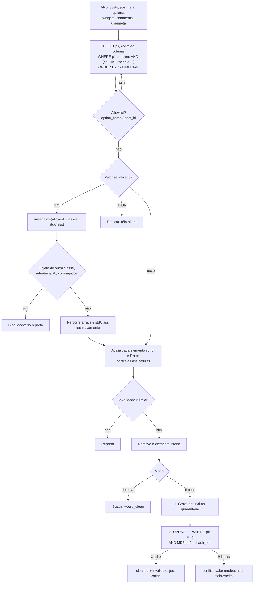

# 🛡️ WP Anti Injection


Plugin WordPress para **detectar e limpar injeções maliciosas gravadas no banco de dados**: `<script>` de host externo, redirecionamentos por `location`, `<iframe>` oculto, payloads `eval(base64_decode(...))` e páginas de **ClickFix / falso captcha** que copiam um comando de PowerShell para a área de transferência da vítima.

Nasceu de resposta a incidentes reais em sites institucionais, em que o atacante já tinha sido removido dos arquivos, mas o banco continuava servindo o redirecionamento. A versão 2.0 é uma reescrita completa das versões 1.x, focada em **não causar dano enquanto limpa**: detecção somente leitura por padrão, quarentena com rollback por item e tratamento correto de dados serializados.

---

## ✨ Funcionalidades

- **Dois modos separados**: `detectar` (padrão, somente leitura) e `limpar` (exige confirmação explícita)
- **Quarentena com rollback**: o valor original é salvo em `{prefix}wpai_quarantine` *antes* de qualquer alteração; cada item pode ser restaurado individualmente
- **Ciente de serialização**: desserializa, percorre arrays/objetos recursivamente, limpa só as strings e re-serializa; nunca aplica regex no blob serializado
- **Remoção cirúrgica**: remove o elemento malicioso inteiro (`<script>…</script>`, `<iframe>…</iframe>`) apenas quando a severidade atinge o limiar; `<script>` legítimo permanece
- **Assinaturas com severidade** (`low` → `critical`), ativáveis/desativáveis pelo painel e extensíveis por filtro
- **Allowlist** por `option_name` (com curinga `*`), por ID de post e por host confiável de `<script src>`
- **Alvos**: posts, postmeta, options, widgets, comments e usermeta
- **Paginação por keyset** com pré-filtro SQL; aguenta bancos grandes pelo WP-CLI
- **WP-CLI** com saída `table`, `json` e `csv`
- **Resultados e log no banco**, nunca em arquivo acessível pela web
- **Multisite** e desinstalação limpa

## ⚙️ Como funciona



Pontos que fazem diferença na prática:

1. **Keyset, não OFFSET.** No modo limpar, as linhas corrigidas deixam de casar com o pré-filtro; com `OFFSET` o conjunto encolhe e registros são pulados. Com `WHERE pk > :ultimo` cada linha é visitada uma única vez.
2. **Tudo ou nada por valor.** Se qualquer parte de um valor não puder ser limpa com segurança, nada é escrito e os achados aparecem como `blocked`.
3. **Escrita condicional.** O `UPDATE` só acontece se o hash atual da coluna for igual ao que foi lido. Uma edição concorrente gera `conflict`, não perda de dados.
4. **Rollback verificado.** A restauração resolve tabela e coluna pela lista fixa de alvos (não confia no que está gravado na quarentena) e recusa se o valor mudou depois da limpeza, a menos que se use `--force`.

## 🔎 Assinaturas

| ID | Escopo | Severidade | O que procura |
|---|---|---|---|
| `script_clickfix` | script | critical | `navigator.clipboard.writeText` **e** `powershell`/`mshta`/`cmd /c`/`curl \| sh` |
| `php_eval_payload` | texto | critical | `eval(base64_decode(` / `gzinflate(` / `str_rot13(` … |
| `script_external_src` | script | high | `<script src>` de host fora do próprio site e da lista de confiáveis; `data:`/`javascript:` |
| `script_eval` | script | high | `eval(` dentro de `<script>` |
| `script_location_redirect` | script | high | `document/window/top.location =`, `location.replace(` / `assign(` |
| `iframe_hidden` | iframe | high | `width/height` 0 ou 1, `display:none`, `visibility:hidden`, `opacity:0`, posição fora da tela |
| `meta_refresh` | texto | high | `<meta http-equiv="refresh" … url=` |
| `fake_captcha_text` | texto | high | texto de "captcha"/"humano" **e** instrução `Win + R` / `Ctrl + V` |
| `script_fromcharcode` | script | medium | `String.fromCharCode(` |
| `script_atob_unescape` | script | medium | `atob(` / `unescape(` |
| `script_hex_obfuscation` | script | medium | 16+ escapes `\xNN` seguidos |
| `php_base64_decode` | texto | medium | `base64_decode(` |

- **Escopo `script` / `iframe`**: a assinatura é avaliada em cada elemento. Se a maior severidade do elemento for ≥ limiar (padrão `high`), o elemento inteiro é removido no modo limpar.
- **Escopo `texto`**: avaliada no que sobra; **sempre só reporta**. Não existe forma segura de "recortar" um payload PHP de dentro de um texto.

**Assinaturas próprias** entram por código, nunca por formulário (regex arbitrária vinda da interface é vetor de ReDoS). Elas são validadas e as inválidas são descartadas:

```php
add_filter( 'wpai_signatures', function ( $sigs ) {
    $sigs['script_meu_ioc'] = array(
        'label'    => 'IoC da campanha X',
        'scope'    => 'script',            // script | iframe | any
        'severity' => 'critical',          // low | medium | high | critical
        'pattern'  => '/\bminhaFuncaoMaliciosa\s*\(/i',
        'needles'  => array( '<script' ),  // literais do pré-filtro SQL
    );
    return $sigs;
} );
```

---

## 📦 Instalação

**Pelo painel**
1. Baixe o repositório como `.zip` (*Code → Download ZIP*).
2. No WordPress: **Plugins → Adicionar novo → Enviar plugin**.
3. Envie o `.zip` e clique em **Ativar**. As tabelas `{prefix}wpai_quarantine` e `{prefix}wpai_log` são criadas na ativação.

**Por FTP/SSH**
```bash
cd wp-content/plugins
git clone https://github.com/lygia-teixeira/wp-anti-injection.git
wp plugin activate wp-anti-injection
```

## 🛠️ Uso pelo painel

Menu **Ferramentas → Anti Injection** (requer `manage_options`).

1. **Detectar**: marque os alvos e clique em *Detectar agora*. Nada é alterado; os achados aparecem com severidade, caminho dentro do valor serializado (ex.: `[2][text]`) e trecho.
2. **Revise.** Se houver falso positivo, adicione a `option_name`, o ID do post ou o host à allowlist em **Configurações**, ou desative a assinatura.
3. **Limpar**: marque a confirmação, digite `LIMPAR` e envie. Cada valor alterado vai antes para a quarentena.
4. **Quarentena**: cada item tem o botão *Restaurar* (rollback individual).

> Em bancos grandes, a requisição do painel pode estourar o tempo limite do PHP. Prefira o WP-CLI.

## 💻 Uso pelo WP-CLI

```bash
# Varredura somente leitura (padrão: todos os alvos)
wp anti-injection scan
wp anti-injection scan --tables=options,widgets --format=json > achados.json
wp anti-injection scan --format=csv > achados.csv

# Limpeza (com backup do banco antes, sempre)
wp db export antes-da-limpeza.sql
wp anti-injection clean --yes

# Quarentena e rollback
wp anti-injection quarantine --status=quarantined
wp anti-injection restore 42
wp anti-injection restore 42 --force   # mesmo que o valor tenha mudado depois

# Assinaturas ativas
wp anti-injection signatures
```

Em `--format=json|csv`, o stdout contém apenas os dados e o resumo vai para o stderr, para não quebrar pipes.

Status possíveis de um item: `reported` (abaixo do limiar ou só texto), `would_clean` (detectar), `cleaned`, `blocked` (não limpável com segurança), `conflict` (valor mudou durante a limpeza), `error`.

## 🔐 Segurança

| Risco | Mitigação no código |
|---|---|
| CSRF nas ações | `wp_nonce_field` + `check_admin_referer` em todo `admin-post` (nonce por item na restauração) |
| Execução por usuário sem permissão | `current_user_can('manage_options')` em cada handler e na renderização |
| Limpeza acidental | modo detectar é o padrão; limpar exige caixa marcada + palavra `LIMPAR` (painel) ou `--yes` (CLI) |
| Perda de dados | original salvo na quarentena antes do `UPDATE`; rollback por item |
| Corromper dados serializados | `unserialize` → percorre → `serialize`; regex só em strings já desserializadas |
| Injeção de objeto PHP ao ler o banco | `unserialize(..., ['allowed_classes' => ['stdClass']])`; outras classes bloqueiam a limpeza |
| Sobrescrever edição concorrente | `UPDATE ... AND MD5(col) = :hash_lido`; 0 linhas → `conflict` |
| Rollback em tabela adulterada | tabela/PK/coluna resolvidas pela lista fixa de alvos, não pelo registro da quarentena |
| SQL injection | `$wpdb->prepare` em todas as consultas; nomes de tabela/coluna vêm de whitelist interna |
| Vazamento do log | resultados e log no banco; nenhum arquivo em `wp-content` |
| XSS ao exibir o código malicioso | `esc_html`/`esc_attr`/`esc_url` em toda saída; mensagens de aviso de lista fixa (nada refletido da URL) |
| Sequências ANSI no terminal | caracteres de controle removidos dos trechos antes de gravar/exibir |
| ReDoS por assinatura personalizada | assinaturas novas só via filtro em código; regex validadas; erro PCRE bloqueia o valor |
| Acesso direto aos arquivos | `defined('ABSPATH') \|\| exit;` / `WP_UNINSTALL_PLUGIN` |

## 📜 Histórico e lições

As versões 1.x foram escritas às pressas durante uma onda de redirecionamentos. Elas "funcionavam" no sentido de encontrar o código malicioso, mas várias decisões podiam causar mais dano do que a própria injeção. Revisá-las com olhar de AppSec foi o motivo desta reescrita.

| Problema nas v1.x | Onde | Consequência | Como a v2.0 resolve |
|---|---|---|---|
| Sem nonce no formulário | 1.0 básica e avançada | CSRF: uma página de terceiros podia disparar a "limpeza" com a sessão de um administrador | nonce + `check_admin_referer` + capability em todo handler |
| Varredura e limpeza no mesmo clique | todas | nenhuma chance de revisar falsos positivos | modos separados; detectar é o padrão |
| Sem backup do valor original | todas | alteração irreversível | quarentena + rollback por item |
| `str_ireplace('<script', '[REMOVED]', …)` | 1.0 básica e avançada | quebra o HTML e **corrompe dados serializados** (`s:N:` deixa de bater, a option passa a valer `false`; widgets e configurações de tema somem); o restante do payload continuava lá | remoção do elemento inteiro, dentro de strings já desserializadas |
| Substituição recalculada a partir do valor original a cada padrão | 1.0 básica e avançada | com dois padrões no mesmo campo, só a última troca era gravada | uma passada por valor, todos os elementos avaliados juntos |
| `preg_replace` de `<script>…</script>` direto em `option_value` | 1.1 | mesma corrupção de serializados, agora "silenciosa" | regex nunca é aplicada no blob serializado |
| Remove **qualquer** `<script>` | 1.1 (e 1.0 por substring) | apaga analytics, chat, embeds legítimos | só remove o elemento que casa com assinatura de severidade ≥ limiar; allowlist |
| `SELECT *` em tabelas inteiras | 1.0 básica e avançada | estoura memória/tempo em bancos reais; percorria até colunas como `guid` e `option_name` | colunas explícitas + pré-filtro `LIKE` + lotes |
| `UPDATE options … WHERE ID = …` | 1.0 básica | `wp_options` não tem coluna `ID` (a PK é `option_id`): a atualização falhava e o log dizia "limpa" | PK correta por tabela em lista fixa |
| `LIMIT … OFFSET …` enquanto as linhas eram alteradas | 1.1 | linhas limpas saem do filtro, o OFFSET avança sobre o conjunto encolhido e **pula registros** | keyset: `WHERE pk > :ultimo ORDER BY pk` |
| Log em `wp-content/wpais-log.txt` | todas | arquivo legível por qualquer visitante: expunha IDs, nomes de opções e o que foi achado (informação útil ao atacante) | log e resultados no banco, acessíveis só a `manage_options` |
| `unserialize`/`maybe_unserialize` implícito em conteúdo possivelmente controlado pelo atacante | (risco ao evoluir a 1.x) | injeção de objeto PHP | `allowed_classes => ['stdClass']` |

A lição principal: **ferramenta de resposta a incidente roda com privilégio máximo sobre dados que o atacante controla**. Ela precisa de mais cuidado do que o código que está corrigindo: padrão somente leitura, reversibilidade, nunca confiar no conteúdo que está analisando e não deixar rastros públicos.

## ⚠️ Limitações

- **Não substitui varredura de arquivos.** Webshells, `wp-config.php` alterado, plugins/temas adulterados e tarefas `cron` maliciosas ficam fora do banco. Se o vetor de entrada não for fechado, a injeção volta.
- **Não substitui restauração de backup** nem troca de credenciais (banco, administradores, chaves `AUTH_*`).
- **Atacante com acesso ao banco pode reinjetar** a qualquer momento, inclusive depois da limpeza. Trate o resultado como contenção, não como erradicação.
- Detecção por assinatura: payloads novos ou muito ofuscados (ex.: só base64 sem `<script>`) podem passar. A allowlist pode esconder um item comprometido se for ampla demais.
- Valores **JSON** (comuns em construtores de página) e serializados com **objetos de classes próprias** são só reportados; a limpeza deve ser manual.
- O pré-filtro usa `LIKE`, que segue a collation da coluna; colunas com collation binária podem exigir as variações de caixa nos `needles`.
- A desinstalação **apaga a quarentena**. Exporte `{prefix}wpai_quarantine` antes se ainda puder precisar de rollback.

## 🧪 Testes

A lógica de limpeza (classes puras) é testada sem WordPress e sem PHPUnit, com stubs mínimos:

```bash
php tests/run.php
```

Cobre: integridade de serializados (inclusive multibyte e dupla serialização), regressão das abordagens das v1.x, preservação de `<script>` legítimo, hosts confiáveis, ClickFix, limiar de severidade, iframes ocultos, `stdClass`, bloqueio de objetos arbitrários (sem executar `__wakeup`), serializados corrompidos, referências `R:`, JSON, trechos sem caracteres de controle e saneamento das configurações.

## 🗂️ Estrutura

```
wp-anti-injection/
├── wp-anti-injection.php           # bootstrap, hooks, WPAI_Plugin::run()
├── uninstall.php                   # remove tabelas e opções (multisite)
├── includes/
│   ├── class-wpai-signatures.php   # assinaturas, validação, filtro
│   ├── class-wpai-settings.php     # configurações, allowlist, hosts
│   ├── class-wpai-cleaner.php      # análise/limpeza ciente de serialização (puro)
│   ├── class-wpai-scanner.php      # alvos, keyset, modo detectar/limpar
│   ├── class-wpai-store.php        # dbDelta, quarentena, rollback, log
│   ├── class-wpai-admin.php        # tela em Ferramentas
│   └── class-wpai-cli.php          # wp anti-injection ...
├── tests/
│   ├── bootstrap.php               # stubs mínimos
│   └── run.php                     # testes sem dependências
├── CHANGELOG.md
└── LICENSE
```

## 🗺️ Roadmap

- [ ] Varredura em segundo plano (Action Scheduler) para o painel em bancos grandes
- [ ] Exportar a quarentena (JSON) pelo painel e pelo CLI
- [ ] `--exit-code` no `scan` para uso em monitoramento/cron
- [ ] Testes de integração com `wp-env` cobrindo `Scanner` e `Store`
- [ ] Assinaturas versionadas em arquivo separado, com IoCs por campanha

---

Desenvolvido por [Lygia Teixeira](https://github.com/lygia-teixeira) · Licença [GPL-2.0-or-later](LICENSE)
